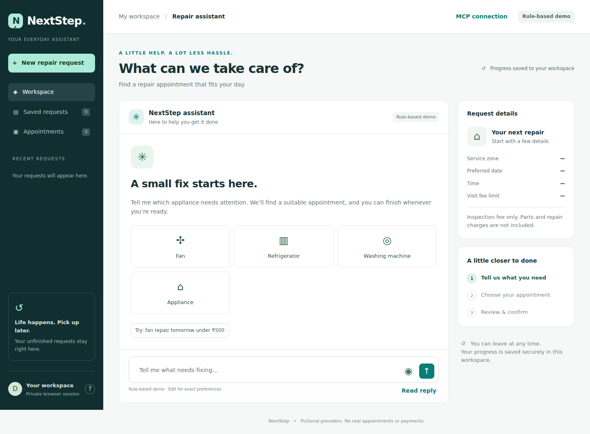

# NextStep

### Appliance repair booking, one conversation at a time.

NextStep is a voice-enabled repair appointment assistant that turns a conversation into a saved, reviewable booking. Describe the problem, set your preferences, compare appointments, and return later without starting over.

**[Try the live demo](https://nextstep-298t.onrender.com)** · **[Source code](https://github.com/PRATIK0SHARMA/NextStep)**

> Public hackathon demo — no signup or access code required. Providers and appointments are fictional; no technician is dispatched and no payment is taken. The free hosting service may take a moment to wake up after inactivity.



*Project screenshot; the live interface may include newer controls.*

## Try it in two minutes

1. Open the [live app](https://nextstep-298t.onrender.com).
2. Type: **“My fan is rattling in Central. Find a visit tomorrow afternoon under 500 rupees.”**
3. Compare the displayed providers and choose a slot, or say **“Choose option 2.”**
4. Try **Save & leave**, then resume the request from **Saved requests**.
5. Review the provider, date, time and visit fee, then click **Confirm booking**.
6. Find the confirmation reference in **Appointments**.

To use voice, allow microphone access and click the microphone button. Review the transcript before sending. Turn **Speaker: on** to hear new assistant replies; **Read reply** repeats the latest reply and **Stop speaking** stops playback. Automatic speech starts off after a page refresh. Browser support and available voices vary.

## What NextStep does

- **Conversational preferences:** collect appliance, issue, zone, date, time and maximum visit fee over multiple messages.
- **Matching appointments:** compare available providers, ordered by visit fee.
- **Save and resume:** retain conversations, preferences and unfinished requests in the database.
- **Safe preference changes:** invalidate an old selection when requirements change and check availability again on resume.
- **Explicit confirmation:** selecting an option never creates a booking; the final browser button does.
- **Duplicate-booking protection:** transactions, unique constraints, revision checks and idempotent confirmation requests protect booking operations.
- **Separate workspaces:** anonymous session cookies keep each browser's requests separate.
- **Voice input and output:** browser speech recognition and text-to-speech complement the typed interface.
- **MCP integration:** six scoped tools let an external assistant work with requests; MCP tools cannot confirm bookings.

The demo supports **fans, refrigerators and washing machines** in **North, Central and South** zones. Appointments cover the next **14 days**, with times interpreted in **Asia/Kolkata**. Amounts are **INR inspection/visit fees**, excluding parts and repair charges.

## How it works

The browser sends typed or transcribed messages to FastAPI. A narrow rule handler resolves explicit commands; other messages use the configured model to propose one bounded action. Pydantic validates the plan, and the service layer checks ownership, current revision and appointment availability before changing data. Replies describe the resulting application state.

The model cannot confirm bookings, execute arbitrary code or make payments. Provider errors are reported rather than silently switching to the rule-based demo.

| Layer | Technology |
|---|---|
| Interface | HTML, CSS and JavaScript |
| Voice | Browser Web Speech APIs |
| API and application logic | Python, FastAPI, Pydantic |
| AI planning | Groq/OpenAI-compatible API, or local Ollama |
| Local storage | SQLite |
| Hosted storage | PostgreSQL on Neon |
| Assistant integration | MCP SDK, Streamable HTTP |
| Hosting and checks | Render, GitHub Actions, pytest |

The frontend and API are served by the same Python application. No separate frontend server or Node build is required.

## Run locally

Use **Python 3.12** and Git.

```bash
git clone https://github.com/PRATIK0SHARMA/NextStep.git
cd NextStep
python -m venv .venv
```

**Windows PowerShell** — activation is optional with these commands:

```powershell
.\.venv\Scripts\python.exe -m pip install -r requirements.lock.txt
Copy-Item .env.example .env
.\.venv\Scripts\python.exe -m uvicorn app.main:app --host 127.0.0.1 --port 8000 --workers 1
```

**macOS / Linux:**

```bash
.venv/bin/python -m pip install -r requirements.lock.txt
cp .env.example .env
.venv/bin/python -m uvicorn app.main:app --host 127.0.0.1 --port 8000 --workers 1
```

Open **http://127.0.0.1:8000**. Startup creates the database and seeds six fictional providers automatically. Leave `DATABASE_URL` blank for local SQLite. The default rule-based demo needs no API key.

If a `.env` already exists, edit it instead of copying over it.

## Configure AI

For an OpenAI-compatible provider such as Groq, edit your private `.env`:

```dotenv
LLM_PROVIDER=compatible
LLM_BASE_URL=https://api.groq.com/openai/v1
LLM_MODEL=YOUR_AVAILABLE_JSON_CAPABLE_MODEL_ID
LLM_API_KEY=YOUR_PRIVATE_API_KEY
LLM_TIMEOUT=30
```

Use a model available in your account that accepts JSON-object output. Restart the server after changing settings. Model access, quotas and costs depend on the provider; a ChatGPT subscription does not supply API credits.

For local Ollama or additional configuration, see [AI setup](docs/AI_SETUP.md). Check current model availability instead of assuming an older example model ID is still supported.

Never commit `.env`, database connection strings, API keys or database backups. Cloud AI receives the request context and recent conversation text; use fictional data when trying the demo. Browser speech recognition may use a remote speech service.

## Deployment

The live app uses **Render for FastAPI and the frontend**, with **Neon PostgreSQL for persistence**. See the [step-by-step free deployment guide](docs/FREE_DEPLOYMENT.md).

Core hosted settings:

```dotenv
APP_ENV=production
PUBLIC_ORIGIN=https://YOUR-SERVICE.onrender.com
DATABASE_URL=YOUR_PRIVATE_POSTGRESQL_CONNECTION_URL
```

Add your model settings through the host's environment settings. This public version does **not** require `ACCESS_CODE`. Keep HTTPS and production mode enabled.

Run **one worker and one instance** for this small-demo architecture. PostgreSQL transactions use an advisory lock to preserve the original serialized booking behavior; this is not designed for high-throughput scaling. Free plans have quotas and can suspend idle compute. The local SQLite backup script does not back up PostgreSQL.

## Tests

```bash
python -m pytest -q
```

Run the command with your virtual environment's Python. GitHub Actions is configured to run the backend suite against both SQLite and a disposable PostgreSQL service. Tests cover ownership isolation, preference validation, stale revisions, conflicting reservations, repeat confirmation requests, public-session behavior, request limits and model-adapter contracts.

**Never point `NEXTSTEP_TEST_DATABASE_URL` at your deployed database.** The PostgreSQL tests reset the test database's public schema. Passing automated tests does not establish live model accuracy or cross-browser voice compatibility.

## MCP and hackathon scope

NextStep includes a Streamable HTTP endpoint at `/mcp/`. Open **MCP connection** in the app to generate a scoped, expiring bearer token for the current workspace. Treat that token as a secret.

See [API and MCP documentation](docs/API_AND_MCP.md) for client setup and tool details.

Built as an **Alexa+ track hackathon prototype**, NextStep demonstrates conversational task completion, persistence and assistant-tool interoperability. It is **not an Amazon-certified Alexa skill** and does not include Alexa account linking. Browser voice features operate independently of Alexa.

## Limitations

- Fictional providers and demo bookings only; no real dispatch, payment, cancellation or rescheduling of confirmed bookings.
- Final booking confirmation requires a button click; this is not a fully hands-free workflow.
- Anonymous browser sessions are not user accounts. Clearing cookies, using another browser, changing the domain or session expiry can remove access to that workspace. Sessions default to 30 days.
- Speech transcription and AI interpretation can make mistakes. Review the details before confirming; the edit form remains available.
- Public access retains basic request limits, but these are not a complete abuse-prevention or commercial security solution.

## Documentation

| Guide | Purpose |
|---|---|
| [Free deployment](docs/FREE_DEPLOYMENT.md) | Current Render + Neon setup |
| [AI setup](docs/AI_SETUP.md) | Cloud and local model configuration |
| [Architecture](docs/ARCHITECTURE.md) | Service design and implementation rationale |
| [API and MCP](docs/API_AND_MCP.md) | Endpoints and external assistant integration |
| [Demo prompts](docs/DEMO_PROMPTS.md) | Example interactions |
| [Presentation notes](docs/PRESENTATION_2_3_MIN.md) | Short pitch and demo cues |

See [validation evidence](docs/VALIDATION.md), [product feedback](docs/FRICTION_LOG.md), and the [submission checklist](docs/SUBMISSION.md) for review details.

## Author

Built by [Pratik Sharma](https://github.com/PRATIK0SHARMA).

## License

[MIT](LICENSE). Dependencies retain their respective licences.
