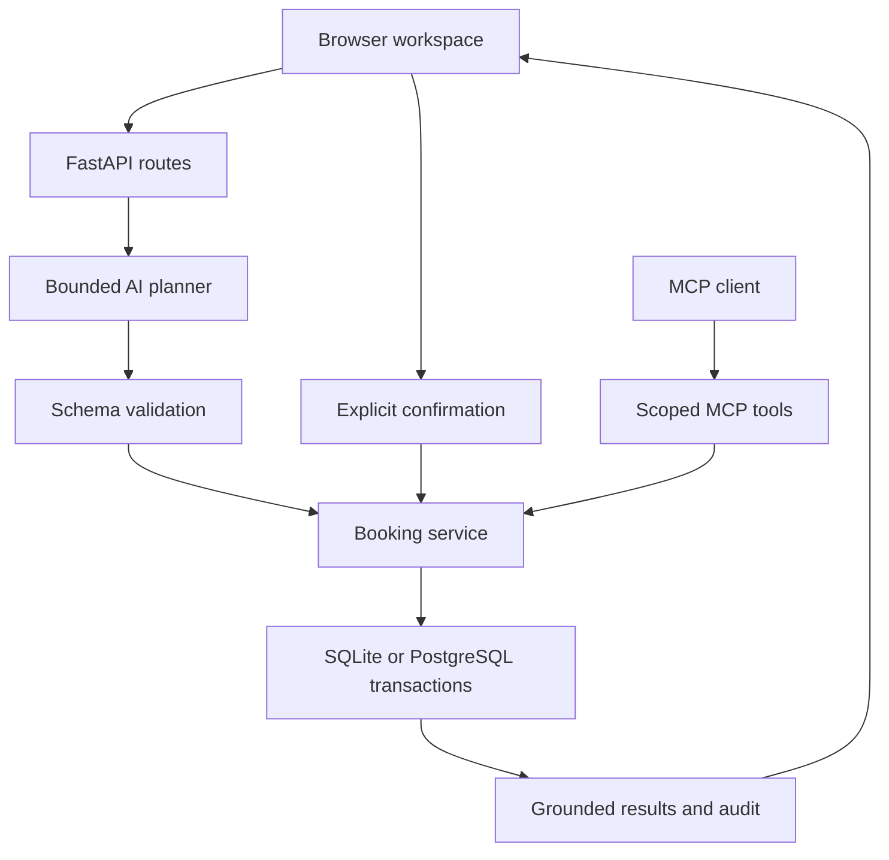

# Architecture and design decisions

## Product objective

NextStep helps a user finish a repair appointment despite interruptions and changed plans. The differentiator is reliable continuity: persist requirements, recheck availability when resuming, invalidate stale selections, and verify the final database result.

## Components

### Why one Python service

One origin removes the cross-origin setup that complicated the earlier two-server scaffold. FastAPI serves the static frontend, authenticated JSON API and MCP endpoint. The distribution needs Python, not a Node build chain. HTML/CSS/JS retains the earlier visual direction while replacing localStorage booking logic with server operations.

### Storage choices

Local runs use SQLite when DATABASE_URL is blank. The hosted demo uses Neon PostgreSQL through psycopg. Parameterized SQL and unique slot/task constraints protect booking operations. SQLite uses BEGIN IMMEDIATE; PostgreSQL uses a transaction-level advisory lock to preserve serialized read/check/write behavior. This prioritizes correctness for a small demo over throughput. Run one worker/instance; redesign locking and load-test before scaling.

Slots, messages and audit records use PostgreSQL identity columns. Dates and JSON remain text to keep the service response contract consistent. Startup initializes a fresh database; it does not import earlier local bookings. The early SQLAlchemy scaffold is not the current implementation.

### Data model

- `sessions`: hashed random browser tokens, workspace identity and expiration.
- `mcp_tokens`: hashed, revocable, 24-hour scoped tokens tied to one workspace.
- `providers`: fictional provider catalog, supported appliances/zones, inspection fee.
- `slots`: provider/date/time inventory.
- `tasks`: requirements, state, selection, revision and timestamps.
- `messages`: persisted conversation history.
- `bookings`: immutable confirmed appointment, fee snapshot, confirmation request ID and confirmed revision.
- `audit`: append-only application events for creation, preferences, selection, resume and confirmation. This is an application audit trail, not a tamper-proof external compliance ledger.
- `schema_version`: current schema marker (1). `initialize` creates missing tables but is not a general schema migration engine. Future releases need explicit migrations.

### State transitions

`collecting_details` -> `choosing_option` -> `awaiting_confirmation` -> `completed`.

Preference changes clear the selected slot and increment revision. Selecting a slot also increments revision. Confirming requires the exact latest revision, selected slot and explicit `confirmed=true`. Resume rechecks availability and clears a taken or past selection. Saving does not need a special state: every accepted change is already committed.

### Booking transaction

1. Look up the task scoped to the session owner.
2. Check if the same confirmation key already completed the same request/slot/revision; return that result on retry.
3. Reject stale revisions or already completed requests.
4. Verify the selected slot and task state.
5. Re-query matching inventory and ensure the slot is unbooked.
6. Insert booking with unique slot and task constraints.
7. Mark task complete, append audit event and grounded confirmation message.
8. Commit all changes together.

Competing app transactions serialize using SQLite BEGIN IMMEDIATE or a PostgreSQL transaction-level advisory lock. If another user books first, the next request sees an unavailable slot. A changed confirmation key cannot create a second booking for a completed task.

### AI design

An LLM produces a small JSON action plan. It does not receive an unrestricted execution environment. Pydantic rejects unknown fields, invalid enums, dates, budgets and option numbers. The executor checks state against the database. User text is untrusted. A prompt-injection attempt cannot introduce a confirmation action because the schema and executor do not contain one.

Model quality still matters: validation cannot prove the model understood a user's intent. Preference and selection changes remain visible, and final booking requires user review. The plan is limited to one action per message to reduce latency and control complexity. This is an agentic workflow, not an autonomous multi-agent system.

### MCP boundary

The official SDK exposes six real tools. Tools and the browser reuse the same service layer; neither duplicates booking rules. The web AI planner calls services in-process for efficiency, while external MCP clients use Streamable HTTP. This is two interfaces to one implementation, not a claim that every browser message traverses MCP.

MCP tokens are manually issued bearer credentials scoped to the browser workspace. This is not OAuth discovery, Alexa account linking or private Alexa SDK access. The intended Alexa+ track path is the self-hosted MCP server, accompanied by a web demonstration. A web simulation alone is not presented as proof of MCP interoperability.

### Security and operations

- HttpOnly, SameSite=Strict cookies; Secure cookies in production.
- Production requires an HTTPS origin. Public session creation needs no shared access code; each browser receives a separate anonymous session.
- Origin and request header checks for mutations, trusted host checks, bounded request bodies.
- Per-process request and chat limits; one replica only. Configure edge protection for a public deployment.
- Model keys only in server environment; MCP/session tokens stored hashed.
- No raw prompts, access codes or tokens intentionally logged. HTTP logs include request ID, status and duration.
- The backend stores conversation text and preferences. The application does not encrypt database contents itself; restrict database access and backups, and use the hosting/database security controls.
- Sessions expire after 30 days by default. No user account recovery, email identity or cross-device login is implemented.

Before a real customer launch: add identity/recovery, consent and retention controls, deletion/export workflows, real provider contracts, monitoring/alerting, managed backups with restore drills, load testing, security review and deployment-specific penetration testing.
